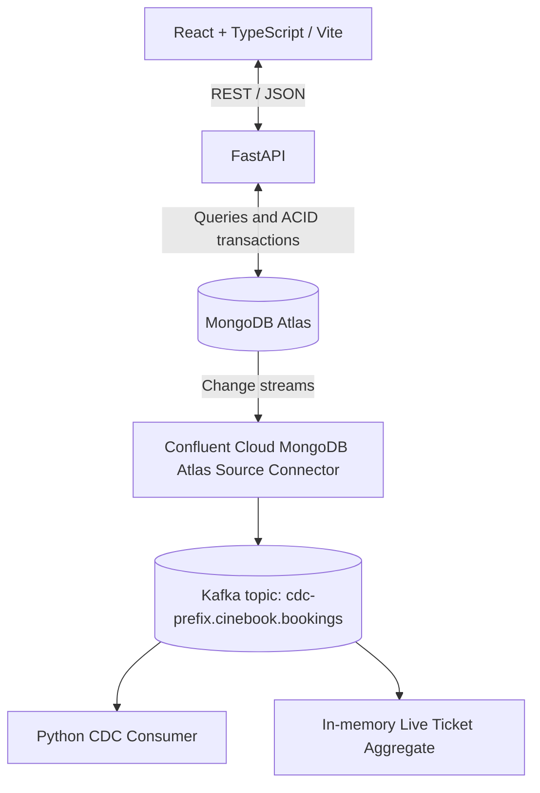

# CineBook — Movie Booking Platform with MongoDB Atlas, FastAPI & Kafka CDC

CineBook is a full-stack movie ticket booking project built with **React + TypeScript**, **FastAPI**, **MongoDB Atlas**, and **Confluent Cloud Kafka**. Users can browse movies and showtimes, inspect seat availability, book multiple seats, and view their bookings. Booking changes are streamed from MongoDB Atlas into Kafka for event consumption and a live ticket-count demonstration.

> **Project scope:** Educational/portfolio implementation. It is not a production payment or ticketing platform. Seat-hold expiration is **not implemented**.

## Architecture



See [architecture details](docs/architecture.md).

## Tech stack

| Layer | Technology |
| --- | --- |
| Frontend | React, TypeScript, Vite |
| API | FastAPI, Python, Pydantic |
| Database | MongoDB Atlas, asynchronous MongoDB access |
| Streaming | MongoDB change streams, Confluent Cloud managed connector, Apache Kafka |
| Kafka clients | Python `confluent-kafka` |
| Development | `uv`, npm, pytest |

## Features

- Browse movies and filter shows by movie and city.
- Inspect per-show seat availability and pricing.
- Book multiple seats atomically: either all requested seats are booked or none are.
- Reject conflicting bookings and prevent duplicate booking creation through an `Idempotency-Key` request header.
- Retrieve bookings and user booking history.
- Calculate movie revenue through an analytics API; additional aggregation scripts cover occupancy, top-performing movies, and peak showtime hours.
- Stream booking changes from MongoDB Atlas to Kafka.
- Consume CDC events and maintain an **in-memory** per-movie ticket count.

## Repository layout

```text
cinebook-mongodb-kafka-cdc/
├── backend/
│   ├── app/
│   │   ├── api/              # FastAPI routers
│   │   ├── core/             # Configuration and logging
│   │   ├── db/               # MongoDB connection/dependencies
│   │   ├── repositories/     # MongoDB queries
│   │   ├── schemas/          # Request and response models
│   │   ├── services/         # Business logic
│   │   └── main.py
│   └── tests/                # Booking concurrency, idempotency, rollback
├── frontend/                 # React + TypeScript application
├── consumers/
│   ├── booking_cdc_consumer.py
│   └── live_ticket_aggregate.py
├── scripts/
│   ├── seed_data.py
│   ├── apply_validation.py
│   ├── create_indexes.py
│   ├── benchmark_queries.py
│   └── aggregations/        # Four MongoDB aggregation scripts
├── docs/
│   ├── architecture.md
│   ├── data_model.md
│   ├── performance_benchmark.md
│   ├── confluent_connector_config.example.json
│   └── openapi.json
├── pyproject.toml
└── README.md
```

## Prerequisites

- Python compatible with `.python-version` / `pyproject.toml` and the [`uv`](https://docs.astral.sh/uv/) package manager.
- Node.js and npm compatible with `frontend/package.json`.
- A MongoDB Atlas cluster that supports the transactions and change streams used by this project.
- For CDC only: a Confluent Cloud Kafka cluster and MongoDB Atlas Source connector.

## Local setup

### 1. Configure the backend

From the repository root:

```bash
uv sync
```

Create a local `.env` containing the settings expected by `backend/app/core/config.py`. **Use the configuration module as the source of truth for exact variable names**; they are not verified in the exported API specification. Never commit `.env` or connection credentials.

### 2. Prepare MongoDB Atlas

After configuring Atlas connectivity, initialize the dataset, validation rules, and indexes as needed:

```bash
uv run python scripts/seed_data.py
uv run python scripts/apply_validation.py
uv run python scripts/create_indexes.py
```

**Caution:** Review these scripts before running them against an existing database; seeding or validation changes can affect stored data. Atlas transactions require an appropriate cluster configuration.

### 3. Start FastAPI

```bash
uv run uvicorn backend.app.main:app --reload
```

- Swagger UI: http://127.0.0.1:8000/docs
- OpenAPI JSON: http://127.0.0.1:8000/openapi.json
- `GET /healthz`: process health; does **not** test MongoDB.
- `GET /readyz`: pings MongoDB and returns HTTP 503 if unavailable.

### 4. Start the React frontend

In another terminal:

```bash
cd frontend
npm ci
npm run dev
```

Check `frontend/.env.example` for frontend environment variable names and configure `frontend/.env` as needed. The development server displays its local URL when it starts.

To verify the production build:

```bash
npm run build
```

## API reference

The following routes were **verified against the exported `docs/openapi.json`**.

| Method | Route | Purpose |
| --- | --- | --- |
| GET | `/movies` | Paginated movie list (`skip`, `limit`) |
| GET | `/movies/{movie_id}` | Movie details |
| GET | `/shows?movie_id=...&city=...` | Paginated shows for a movie and city |
| GET | `/shows/{show_id}` | Show details, seat statuses and prices |
| POST | `/bookings` | Create a booking with required `Idempotency-Key` UUID header |
| GET | `/bookings/{booking_id}` | Fetch a booking |
| GET | `/users/{user_id}/bookings` | Paginated user booking history |
| GET | `/analytics/revenue` | Revenue, booking count, and seats sold per movie |
| GET | `/` | Welcome response |
| GET | `/healthz` | API health |
| GET | `/readyz` | MongoDB readiness |

The booking request contains `user_id`, `show_id`, and a non-empty `seats` array. Example:

```bash
curl -X POST http://127.0.0.1:8000/bookings \
  -H 'Content-Type: application/json' \
  -H "Idempotency-Key: $(python -c 'import uuid; print(uuid.uuid4())')" \
  -d '{"user_id":"USR-0001","show_id":"SHW-000001","seats":["A1","A2"]}'
```

Use existing valid IDs and available seats from your database; the example values are illustrative. The same idempotency key should be reused only for a retry of the **same** request. The application has been tested for successful bookings, duplicate retries, and seat conflicts; actual success/conflict status codes are determined by the implementation (the OpenAPI export documents only some responses).

For the complete generated request and response schemas, see [`docs/openapi.json`](docs/openapi.json).

## MongoDB data model

The `cinebook` database uses five collections:

| Collection | Role |
| --- | --- |
| `movies` | Movie catalog and availability metadata |
| `theaters` | Theater metadata |
| `shows` | Show schedule, pricing, and embedded seat states |
| `users` | User records |
| `bookings` | Booking records and denormalized booking context |

Seat state is embedded in `shows` to support coordinated seat updates. Bookings reference users and shows and retain fields such as movie title, theater, city, and price breakdown for convenient retrieval and analytics. See [`docs/data_model.md`](docs/data_model.md) for design details.

### Booking consistency

The booking service uses MongoDB transactions to check and update requested seats and insert the booking as one unit. If any requested seat is unavailable, the booking is rejected rather than partially succeeding. A unique `(user_id, idempotency_key)` index supports retry-safe booking creation. The repository contains tests for concurrent bookings, idempotency, and transaction rollback.

### Schema validation and indexes

Validation scripts are provided for the `shows` and `bookings` collections. The index setup includes:

| Collection | Index | Keys |
| --- | --- | --- |
| `movies` | `idx_movies_cities_language` | `cities`, `language` |
| `theaters` | `idx_theaters_city` | `city` |
| `shows` | `idx_shows_movie_city_start` | `movie_id`, `city`, `start_time` |
| `bookings` | `idx_bookings_user_created` | `user_id`, `created_at` descending |
| `bookings` | `uq_bookings_user_idempotency` | `user_id`, `idempotency_key` (unique) |
| `bookings` | `idx_bookings_show` | `show_id` |

The compound `shows` index follows the equality/sort access pattern for filtering by `movie_id` and `city` and ordering by `start_time`.

## Analytics and query benchmarking

MongoDB aggregation pipelines are maintained in:

- [`scripts/aggregations/revenue_per_movie.js`](scripts/aggregations/revenue_per_movie.js)
- [`scripts/aggregations/occupancy_per_show.js`](scripts/aggregations/occupancy_per_show.js)
- [`scripts/aggregations/top_performing_movies.js`](scripts/aggregations/top_performing_movies.js)
- [`scripts/aggregations/peak_showtime_hours.js`](scripts/aggregations/peak_showtime_hours.js)

Only **revenue per movie** is exposed as an analytics endpoint in the supplied OpenAPI export. The remaining pipelines are repository scripts, not documented HTTP routes.

The benchmark script is [`scripts/benchmark_queries.py`](scripts/benchmark_queries.py); recorded results are in [`docs/performance_benchmark.md`](docs/performance_benchmark.md). A previous test compared an unindexed collection scan against indexed execution for a booking lookup:

| Metric | Forced collection scan | Indexed lookup |
| --- | ---: | ---: |
| Documents examined | 104 | 5 |
| Index keys examined | 0 | 5 |
| Execution time | 1 ms | 1 ms |

This is a **95.19% reduction in documents examined**, **not** a demonstrated runtime speedup. The dataset is too small for meaningful latency conclusions. An Atlas Explain Plan also verified use of the `shows` compound index with no in-memory sort for a movie/city/start-time query. Refer to the benchmark report for reproducibility and evidence.

## Change Data Capture (CDC) with Kafka

CineBook uses a managed **MongoDB Atlas Source** connector in Confluent Cloud to publish booking collection changes to Kafka.

```text
MongoDB Atlas: cinebook.bookings
    → MongoDB change stream
    → Confluent Cloud MongoDB Atlas Source connector
    → Kafka topic: cdc-prefix.cinebook.bookings
    → Python consumers
```

Connector settings (with secrets replaced by placeholders) are stored in [`docs/confluent_connector_config.example.json`](docs/confluent_connector_config.example.json). The example uses JSON key/value formats, `bookings` collection, `cinebook` database, `cdc-prefix` topic prefix, and one connector task. Actual Confluent credentials and MongoDB connectivity must be configured separately.

Run the consumers from the repository root after setting the environment variables required by their code:

```bash
uv run python consumers/booking_cdc_consumer.py
```

For the bonus live aggregation, run a separate process:

```bash
uv run python consumers/live_ticket_aggregate.py
```

The CDC consumer displays booking change events. The live aggregator maintains ticket totals by movie in memory, accounting for already-seen booking IDs within a running process to avoid double-counting replayed events.

**Delivery semantics and limitations:** Kafka consumption is generally at least once, so duplicate delivery is possible. MongoDB change stream resume tokens support resuming a stream, while Kafka consumer offsets govern downstream replay. The live ticket aggregator's in-memory state **is not durable**: restarting the process with previously committed offsets can produce incomplete totals. Rebuilding state requires a suitable replay strategy and retained history. This demo does not claim production-grade exactly-once processing.

## Tests and verification

Backend tests include:

```bash
uv run pytest backend/tests
```

Relevant test modules:

- `test_booking_concurrency.py`
- `test_booking_idempotency_concurrency.py`
- `test_booking_transaction_rollback.py`

Additional scripts in `scripts/` check Atlas connectivity, validators, transactions, and change streams. Some tests require a configured Atlas database and may create or change records; inspect test setup before running against important data.

Suggested evidence for submission: successful booking, conflicting-seat rejection, analytics output, index `IXSCAN` versus `COLLSCAN` evidence, Kafka booking CDC event, and live aggregate update. Store screenshots under `docs/screenshots/` if available, and link them from this README after adding the actual files.

## Security and operational notes

- Do **not** commit `.env`, `frontend/.env`, API keys, MongoDB passwords, or live connection strings.
- Check tracked files with `git ls-files` because `.gitignore` does not remove already-tracked secrets.
- Restrict MongoDB Atlas network access; a broad `0.0.0.0/0` allowlist should not be left enabled unnecessarily.
- Stop or delete unused Confluent Cloud resources to avoid ongoing charges.
- This project does not include payment processing, durable seat holds, or production-grade distributed recovery for the live aggregate.

## License

See [`LICENSE`](LICENSE).
