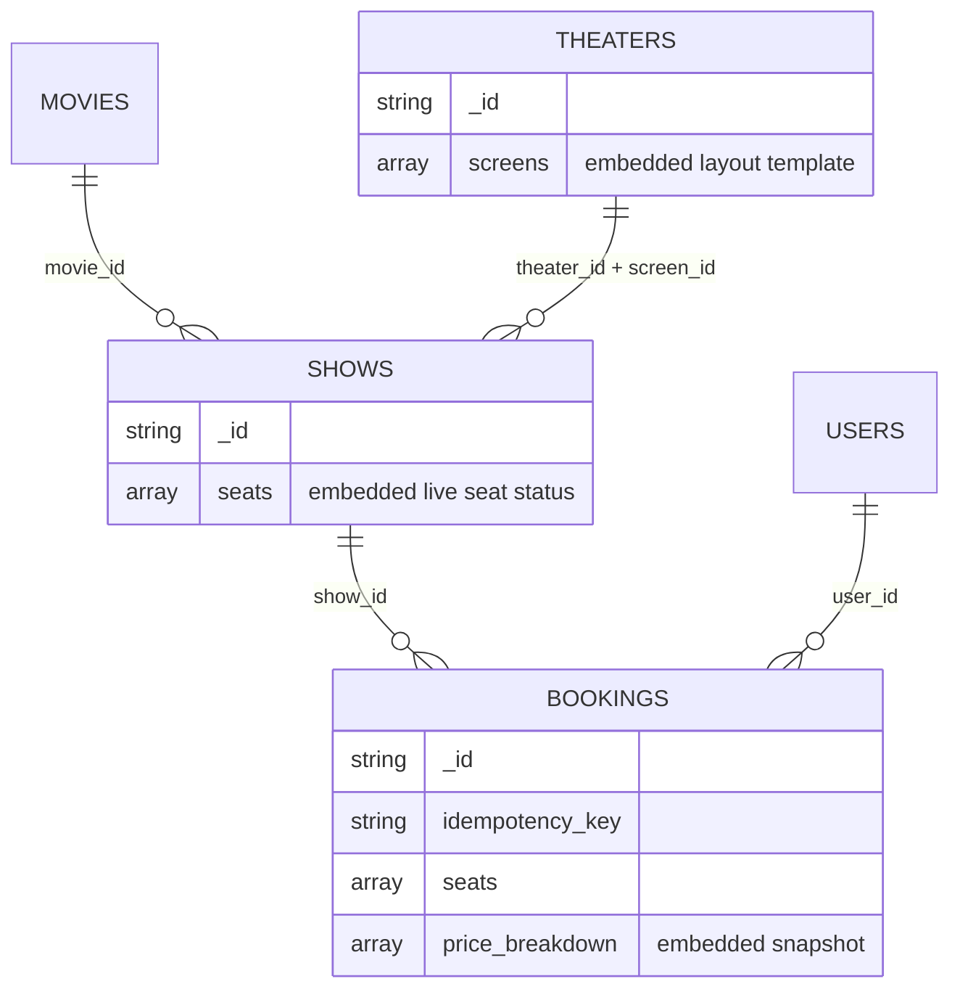

# CineBook — Data Model and Booking Consistency Design (Part A)

**Status:** Revision 2. Incorporates the first design review; awaiting approval. Nothing in this document has been implemented or verified against a live cluster yet.
**Scope:** Assignment Part A (data modeling), plus the reservation, consistency, retry and seed-data plan that Parts B–E will implement.

Sample documents are written in **MongoDB Extended JSON** so BSON types are explicit: `{"$date": "..."}` is a BSON `Date` (UTC). All examples are valid JSON with no comments. Where an example is shortened, the surrounding text says so. The field names from the assignment's sample documents (§3) are unchanged; added fields are marked **(added)**.

---

## 1. Collections at a glance

| Collection | One document is | `_id` | Seed volume | Embeds | References |
|---|---|---|---|---|---|
| `movies` | a film | natural key `MOV-<SLUG>` | 5 | — | — |
| `theaters` | a cinema venue | natural key `THR-<CITY>-<NN>` | 3 (Delhi, Mumbai, Bengaluru) | `screens[]` (layout template) | — |
| `shows` | one screening of a movie on a screen at a time | `SHW-<NNNNNN>` | 15 | `seats[]` (**live availability**) | `movie_id`, `theater_id`, `screen_id` |
| `bookings` | one confirmed purchase of 1+ seats | `BKG-<32 hex>` (app-generated) | ≈100, created **through the API** | `price_breakdown[]` (snapshot) | `show_id`, `user_id` (+ denormalized copies) |
| `users` | a synthetic customer (no auth) | natural key `USR-<NNNN>` | 50 | — | — |



---

## 2. Document shapes

### 2.1 `movies`

```json
{
  "_id": "MOV-DUNE2",
  "title": "Dune: Part Two",
  "language": "English",
  "genres": ["Sci-Fi", "Adventure"],
  "duration_min": 166,
  "certification": "UA",
  "release_date": {"$date": "2024-03-01T00:00:00Z"},
  "cities": ["Delhi", "Mumbai", "Bengaluru"]
}
```

- **Decision:** `release_date` is a BSON `Date` (midnight UTC), not the string shown in the PDF. This follows the assignment's tip to use real date types and allows date-range queries.
- `cities` is a **denormalized** list of the cities where the movie has shows. It supports `GET /movies?city=` without a `$lookup` into `shows`. The seed script derives it from the shows it inserts. Trade-off: it would go stale if shows were changed outside the seed script, which doesn't happen in this project. Reseeding recomputes it.

### 2.2 `theaters` — screens embedded

```json
{
  "_id": "THR-DEL-01",
  "name": "Downtown Cineplex",
  "city": "Delhi",
  "screens": [
    {
      "screen_id": "SCR-1",
      "name": "Audi 1",
      "rows": ["A", "B", "C", "D", "E"],
      "seats_per_row": 10,
      "categories": { "A-B": "PREMIUM", "C-E": "REGULAR" }
    }
  ]
}
```

- The screen layout is a **template only**. It never holds live availability. `screen_id` is unique within its theater, so a screen is identified by `(theater_id, screen_id)`.
- `categories` keys are inclusive row ranges (`"A-B"`, or a single row such as `"A"`). The seed script expands them into per-seat categories when it creates a show and fails if any row is uncategorized.

### 2.3 `shows` — per-show seat inventory embedded

The example below is shortened: the real `seats` array has one entry per physical seat (A1–E10, 50 entries). Only three entries are shown, so `seats_total` and `seats_available` describe the full document, not the excerpt.

```json
{
  "_id": "SHW-000001",
  "movie_id": "MOV-DUNE2",
  "theater_id": "THR-DEL-01",
  "screen_id": "SCR-1",
  "city": "Delhi",
  "start_time": {"$date": "2026-11-20T13:00:00Z"},
  "status": "SCHEDULED",
  "prices": { "PREMIUM": 450, "REGULAR": 300 },
  "seats_total": 50,
  "seats_available": 48,
  "seats": [
    { "seat": "A1", "category": "PREMIUM", "status": "BOOKED", "booking_id": "BKG-3f9a0c71e2d44b6a9c1e5f7a2b8d0c13" },
    { "seat": "A2", "category": "PREMIUM", "status": "AVAILABLE" },
    { "seat": "A5", "category": "PREMIUM", "status": "BOOKED", "booking_id": "BKG-3f9a0c71e2d44b6a9c1e5f7a2b8d0c13" }
  ]
}
```

Fields added beyond the PDF's suggested shape:

| Field | Why |
|---|---|
| `status` **(added)** — enum `SCHEDULED`, `CANCELLED` | Lets the booking update atomically refuse non-bookable shows (§4.1). |
| `seats[].booking_id` **(added)** — present only while `BOOKED` | Traces each seat back to the booking that owns it. Used by the CDC update script (§8) and by consistency checks. |
| `seats_total`, `seats_available` **(added)** | Cheap seats-left and occupancy values. `seats_available` changes **in the same single-document update** that flips the seats. |

**Invariant for every show:** `seats_total == len(seats)`, and `seats_available == count(seats where status == "AVAILABLE")`. It is checked:
- by the seed script, before inserting each show and again after seeding;
- by a `check_setup` script in Phase B, across all shows;
- by the Phase C tests after the concurrency test and the failure-injection test;
- by a final consistency check after the ≈100 API bookings: every `BOOKED` seat's `booking_id` points to a `CONFIRMED` booking for that show, and each booking's `seats` are exactly the seats stamped with its ID.

Other notes:
- `city` is denormalized from the theater (already in the PDF shape). The browse query (`movie_id`, `city`, `start_time`) can then use one collection and one compound index.
- `start_time` is a BSON `Date` in UTC. Seed showtimes are defined in IST (`Asia/Kolkata`) and converted to UTC.

### 2.4 `bookings`

```json
{
  "_id": "BKG-3f9a0c71e2d44b6a9c1e5f7a2b8d0c13",
  "idempotency_key": "0b6f3c2e-6a51-4f0e-9d7c-2f8a1e4b5c90",
  "show_id": "SHW-000001",
  "user_id": "USR-0007",
  "seats": ["A1", "A5"],
  "amount": 900,
  "status": "CONFIRMED",
  "created_at": {"$date": "2026-11-06T18:40:12.315Z"},
  "movie_id": "MOV-DUNE2",
  "movie_title": "Dune: Part Two",
  "theater_id": "THR-DEL-01",
  "screen_id": "SCR-1",
  "city": "Delhi",
  "show_start_time": {"$date": "2026-11-20T13:00:00Z"},
  "price_breakdown": [
    { "seat": "A1", "category": "PREMIUM", "price": 450 },
    { "seat": "A5", "category": "PREMIUM", "price": 450 }
  ]
}
```

- `status` enum: `CONFIRMED`, `CANCELLED`. A booking document exists **only** once its seats are actually held, so there is no `PENDING` or `FAILED` state. A failed attempt leaves no booking and no CDC event. `CANCELLED` is reached only through the controlled CDC test script (§8), not through the API.
- `idempotency_key` **(added)** is the client-supplied retry key (§5.3). A unique index on `(user_id, idempotency_key)` guarantees one booking per key.
- `amount` is computed **on the server** as the sum of `price_breakdown[].price`, with prices taken from `shows.prices[category]`. Any client-sent amount is ignored.
- `seats` stays a plain string array, as in the PDF, so ticket counts are just `$size: "$seats"`.
- Booking records and seat inventory are kept separate. The booking is the **commercial record**; `shows.seats[]` is the **inventory**. They are linked both ways through `show_id` and `seats[].booking_id`.

### 2.5 `users`

```json
{
  "_id": "USR-0007",
  "name": "Ananya Iyer",
  "email": "user0007@example.com",
  "city": "Mumbai",
  "created_at": {"$date": "2026-10-01T00:00:00Z"}
}
```

These are 50 deterministic synthetic users (§9). There is no authentication: the API trusts the `user_id` in the request, which will be documented as a limitation. Booking history is **not** embedded in the user document (§3). Emails use the reserved `example.com` domain.

---

## 3. Embed vs reference decisions

| Relationship | Decision | Justification |
|---|---|---|
| Screens → theater | **Embed** | Few per theater (bounded). Owned by the theater with no independent life. Always read together. Rarely changes. |
| Seat status → show | **Embed** | **This is what makes reservations atomic.** MongoDB guarantees atomicity per document, so putting all of a show's seats in one document lets a single conditional update check and flip any set of seats all-or-nothing (§4). The array is bounded by screen capacity: 50 entries × ~100 bytes ≈ 5 KB, and even a 500-seat screen is far below the 16 MB document limit. |
| Seat status → theater screen | **Not stored** | Availability belongs to a screening, not a room. Storing it on the screen would let shows share state. |
| Show → movie, theater, screen | **Reference** | Many-to-one, with independent lifecycles. Embedding the movie in every show would duplicate data and make movie edits fan out. |
| Booking → show | **Reference** (`show_id`) **+ selective denormalization** | A show has many bookings over time. Embedding bookings inside shows would grow a hot document, mix commercial records with inventory, and make per-user history queries expensive. |
| Booking → user | **Reference** (`user_id`) | A user's history grows without bound, so it must not be embedded in `users`. History is an indexed query on `bookings` by `user_id`. |
| Price breakdown → booking | **Embed** | Belongs to one booking and is a point-in-time snapshot. |

---

## 4. Atomic all-or-nothing seat reservation

### 4.1 The conditional update

For a request reserving seats `S = ["A1", "A5"]` under the new booking ID `B`:

```python
now = datetime.now(timezone.utc)
result = shows.update_one(
    {
        "_id": show_id,
        "status": "SCHEDULED",
        "start_time": {"$gt": now},
        "seats": {"$all": [
            {"$elemMatch": {"seat": s, "status": "AVAILABLE"}} for s in S
        ]},
    },
    {
        "$set": {
            "seats.$[t].status": "BOOKED",
            "seats.$[t].booking_id": B,
        },
        "$inc": {"seats_available": -len(S)},
    },
    array_filters=[{"t.seat": {"$in": S}, "t.status": "AVAILABLE"}],
    session=session,
)
reserved = result.matched_count == 1
```

- **All-or-nothing:** the filter matches only when *every* requested seat is `AVAILABLE`. If any seat is taken, nothing matches and **no seat changes**. Partial success cannot happen.
- **Several seats in one operation:** `$[t]` with `arrayFilters` updates every selected array element in one write. The PDF's single-seat hint uses positional `$`, which only updates the first match.
- **Show state is checked in the same write:** `status` and `start_time` are in the filter. A show that was cancelled or has started can't be booked, even if it looked valid when the API first read it.

### 4.2 Why two competing requests cannot both succeed

1. All requested seats are in **one** show document. MongoDB applies a single-document update atomically: evaluating the filter and applying the change are one operation that no other writer can interleave with.
2. When two requests target seat `A1`, WiredTiger detects a write conflict on the document and lets only one write commit. Inside a transaction the loser gets a `WriteConflict` (`TransientTransactionError`), and PyMongo's `with_transaction` retries the whole callback. The retry **re-evaluates the filter against the committed version**, where `A1` is `BOOKED`. `$elemMatch: {seat: "A1", status: "AVAILABLE"}` fails, `matched_count == 0`, and the request gets 409.
3. There is **no read-then-write gap.** The API reads the show beforehand only to validate seat IDs and look up prices, which never change. **Availability is decided only by the conditional update.**

Trade-off: every booking for a show writes the same document, so concurrent bookings for *different* seats of one show are serialized and may retry. That is acceptable at this scale; very hot shows would see contention, which is a documented limitation.

### 4.3 `POST /bookings` algorithm

```
headers: Idempotency-Key: <client-generated UUID>   (required)
body:    show_id, user_id, seats[]                  (no client amount accepted)

1. Validate request          → 400 if Idempotency-Key missing/malformed, seats empty,
                                duplicate seat IDs, or malformed IDs
2. Idempotent replay check   → booking with (user_id, idempotency_key) exists?
                                same show_id + same seat set → 200 with that booking
                                different payload            → 422 (key reused)
3. users.find_one(user_id)   → 404 if missing
4. shows.find_one(show_id)   → 404 if missing
                              → 409 if status != SCHEDULED or start_time <= now
5. Map seat → category from the show; any unknown seat → 400
6. Compute price_breakdown and amount from show.prices (server side)
7. booking_id = "BKG-" + secrets.token_hex(16)
8. Transaction (§5): conditional update (§4.1), then bookings.insert_one
9. Outcome handling:
     committed                        → 201 with the booking
     SeatsUnavailable or DuplicateKey → re-run step 2 (a concurrent retry with the
                                        same key may have won) → 200 if found;
                                        otherwise re-read the show:
                                          show not bookable → 409 "show not bookable"
                                          else              → 409 + unavailable_seats
     commit outcome unknown           → §5.3
```

**Status codes:** 400 invalid request · 404 unknown show or user · **409 seats unavailable *or* show not bookable** (cancelled or already started) · 422 idempotency key reused with a different payload · 503 commit outcome could not be confirmed (safe to retry with the same key).

**What happens to the booking if only some seats were available** (asked in the PDF): no booking document is created, none of the requested seats change, and the client gets 409 listing the seats that were unavailable at check time. The frontend refreshes the seat map.

---

## 5. Cross-document consistency and retries

### 5.1 The problem

The seat update (`shows`) and the booking insert (`bookings`) are **two writes to two documents in two collections**. Single-document atomicity only covers the first. Running them as separate operations, as the PDF's hint implies, means a failed insert would leave seats `BOOKED` with no booking: seats are lost and the customer has no record.

### 5.2 Primary strategy: one multi-document transaction

```python
class SeatsUnavailable(Exception):
    pass

def _txn(session):
    res = shows.update_one(seat_filter, seat_update, array_filters=af, session=session)
    if res.matched_count != 1:
        raise SeatsUnavailable()
    bookings.insert_one(booking_doc, session=session)

with client.start_session() as session:
    session.with_transaction(
        _txn,
        read_concern=ReadConcern("snapshot"),
        write_concern=WriteConcern("majority"),
        read_preference=ReadPreference.PRIMARY,
    )
```

| Failure point | Outcome |
|---|---|
| Seats not all available | `SeatsUnavailable` → abort → 409. Nothing written. |
| Write conflict with a concurrent booking | Transient error → `with_transaction` retries the callback → either succeeds or raises `SeatsUnavailable`. |
| Booking insert fails (schema validation, duplicate idempotency key) | Exception → abort → **seat update rolled back**. Handled by §4.3 step 9. |
| App crashes mid-transaction | Uncommitted writes are invisible. The server aborts the transaction when its lifetime limit (60 s default) expires; competing writers get conflicts until then. |
| Commit outcome unknown | §5.3. |

Because change streams publish a transaction's writes **only when it commits**, the Kafka topic (Part E) never sees a booking whose seats were rolled back.

**Contingency (not designed or implemented now):** compensation logic, i.e. releasing seats after a failed insert plus an orphan sweep, will only be designed and implemented if Atlas M0 transactions **fail** the Phase B verification (§10, #1). If that happens, I'll stop and present the design for approval first.

Relation to Part G: the bonus "multi-seat transaction" is about doing the *multi-seat reservation itself* inside a transaction instead of one conditional update. This design reserves all seats with **one conditional update** (core Part C) and uses the transaction only to **bind the booking insert to it**. The README will describe it that way and will not claim the bonus.

### 5.3 Unknown commit outcomes and safe client retries

**Where uncertainty comes from.** If the network fails or the primary steps down while `commitTransaction` is in flight, the driver raises `UnknownTransactionCommitResult`. The transaction may or may not have committed. The same uncertainty exists one level up: the client may time out waiting for the HTTP response even though the booking committed.

**Server side (inside one HTTP request):**
1. `with_transaction` automatically retries `commitTransaction` on `UnknownTransactionCommitResult`. Commit retries are safe: the server recognizes the session and transaction number and won't apply the transaction twice.
2. If the outcome is still unknown when `with_transaction` gives up, the handler **does not guess**. It reads `bookings.find_one({"_id": booking_id})` from the primary with majority read concern:
   - found → the transaction committed → respond 201 with the booking;
   - not found, or the read also fails → respond **503** `{"detail": "booking outcome unknown, retry with the same Idempotency-Key", "booking_id": ...}`.

**Client side: retrying with the same `Idempotency-Key`:**
- Every booking attempt carries a client-generated UUID in the `Idempotency-Key` header. The frontend generates one per "Book" click and reuses it for any retry of that click (timeouts, network errors, 503).
- The key is stored on the booking, and a **unique index on `(user_id, idempotency_key)`** guarantees at most one booking per key, even under concurrent retries.

| Scenario | Result of retrying with the same key |
|---|---|
| Original committed; client never saw the response | Step 2 replay check finds the booking → **200** with the original booking, no second reservation. |
| Original did not commit | No booking exists → normal processing → 201, or 409 if the seats have since been taken. |
| Original commit still in flight when the retry arrives | The retry either conflicts on the show document or hits the unique key → step 9 re-checks the key → **200** with the original booking once it is visible. At most one booking can ever exist for the key. |
| Same key reused for a different show or seat set | **422**: the client is misusing keys. |

**Limits (to document):** a retry *without* the original key is treated as a new purchase. If the seats are still held by the original booking, that retry gets 409 rather than a duplicate, but the user may need to check their booking history. Idempotency keys are kept indefinitely (no TTL) at this scale.

---

## 6. `_id` choices

| Collection | `_id` | Rationale |
|---|---|---|
| `movies` | `MOV-<SLUG>` natural key (e.g. `MOV-DUNE2`) | Readable, stable, matches the PDF. Makes seeding **idempotent** (upsert by `_id`) and gives readable references in shows and bookings. |
| `theaters` | `THR-<CITY>-<NN>` | Same reasons. Stable venue identity. |
| `shows` | `SHW-<NNNNNN>`, deterministic in the seed | Readable in URLs and logs. Deterministic IDs let reseeding upsert instead of duplicating. |
| `bookings` | `BKG-` + `secrets.token_hex(16)`: **128 bits** from the OS CSPRNG (32 hex characters) | The ID has to exist *before* the write so it can be stamped on `seats[].booking_id` in the same update. At 128 bits a collision is negligible even at billions of bookings, and the ID is unguessable for URLs. If a collision ever happened, the `_id` unique constraint would abort the transaction (seats rolled back) rather than corrupt data. ObjectId would also work but is only 96 bits and partly predictable (timestamp + counter). |
| `users` | `USR-<NNNN>` natural key | Matches the PDF style. Seed data only. `email` gets a unique index. |

Every point lookup (`GET /bookings/{id}`, the show fetch, user existence checks) uses the built-in `_id` index.

---

## 7. Intentional denormalization and trade-offs

| Denormalized field | Copied from | Why | Consistency trade-off |
|---|---|---|---|
| `shows.city` | `theaters.city` | Single-collection browse by movie + city + time with one ESR index. | A theater changing city is not realistic. Accepted. |
| `shows.seats[].category` | theater screen `categories` | Price lookup per seat without parsing row ranges. | Layout is fixed once the show exists; intended snapshot. |
| `shows.seats_available`, `seats_total` | derived from `seats[]` | O(1) seats-left and occupancy. | Updated in the **same atomic update** as `seats[]`. Verified by the invariant checks in §2.3. |
| `movies.cities` | derived from `shows` | `GET /movies?city=` without `$lookup`. | Stale if shows change outside the seed script. Reseed recomputes it. |
| `bookings.movie_id`, `movie_title`, `theater_id`, `screen_id`, `city`, `show_start_time` | show / movie | Revenue, top-movies and peak-hour pipelines can `$group` on `bookings` without `$lookup`. History renders without joins. **CDC events are self-describing** downstream. | A movie rename or show reschedule leaves old values on existing bookings. That is acceptable, even desirable, for a commercial record of what was sold. Phase D will still show the PDF's "join shows to movies" approach in at least one pipeline. |
| `bookings.price_breakdown`, `amount` | `shows.prices` at booking time | Price snapshot; later price changes must not rewrite historical revenue. | Intended immutability. |

---

## 8. CDC update events without a cancellation API

There is **no cancel endpoint**; the API surface stays as the plan specifies. Part E still needs *update* events as well as inserts, so Phase E will add a controlled script, `scripts/cdc_update_booking.py`:

- It takes an explicit `--booking-id` (no wildcard or bulk mode) and supports `--dry-run`.
- In **one transaction** it sets the booking's `status` to `CANCELLED` (plus `cancelled_at`), and releases exactly the seats stamped with that `booking_id` (`status` → `AVAILABLE`, `booking_id` removed, `seats_available` incremented). The §2.3 invariants therefore still hold.
- It refuses bookings that are already `CANCELLED`, and refuses if the stamped seats don't match the booking's `seats`.
- Its use is documented as a test and demo tool only. It produces a CDC `update` event on `cinebook.bookings` that we can inspect in the topic.

---

## 9. Seed and sample data plan (deterministic)

| Data | Volume | How | Determinism |
|---|---|---|---|
| Movies | 5: Dune: Part Two (English), Oppenheimer (English), Jawan (Hindi), Kantara (Kannada), RRR (Telugu) | `scripts/seed_data.py`, upsert by `_id` | Fixed list. `cities` derived from the shows. |
| Theaters | 3: Delhi, Mumbai, Bengaluru, 1–2 screens each (32–60 seats per screen, 2–3 categories) | seed script, upsert | Fixed list. |
| Shows | 15, spread over the next 3 days at varied IST times (morning to late night) for peak-hour analytics | seed script | Fixed specs (movie, screen, day offset, local time, prices). Start times are relative to the run date so they are always in the future. Each show is checked against the §2.3 invariant before insert. No two shows overlap on the same screen. |
| Users | 50: `USR-0001`…`USR-0050` | seed script, upsert | Names from fixed lists combined by index; emails `user0001@example.com`; cities assigned round-robin. |
| Bookings | ≈100, **created through `POST /bookings`** (after Phase C) | `scripts/generate_bookings.py` calls the running API sequentially | `random.Random(42)` picks the user, show (weighted so occupancy varies) and 1–4 adjacent available seats. Each request's `Idempotency-Key` is `uuid5(namespace, "cinebook-sample-<n>")`, so **rerunning the script replays instead of duplicating**. |

Notes:
- Re-running `seed_data.py` upserts reference data. **It won't overwrite a show that has booked seats** unless run with an explicit `--reset`, which also deletes all bookings so shows and bookings stay consistent.
- Some values are deterministic and some aren't. Deterministic: IDs, structure, user/show/seat choices. Not deterministic: `created_at` timestamps, booking `_id`s, and absolute `start_time`s (relative to the run date). Aggregation results will therefore have the same totals across runs from a clean reset, but different timestamps.
- Total capacity is about 15 × 45 ≈ 675 seats; ≈100 bookings × 1–4 seats ≈ 250 seats gives a realistic spread of occupancy.
- Creating bookings through the API, rather than inserting them directly, means the sample data passes through the same validation, pricing and transaction code. It also produces real CDC events if the connector is running.

---

## 10. Atlas M0 assumptions and database users — to verify in Phase B/E

### 10.1 Capability assumptions (none verified yet)

| # | Assumption | Why it matters | How we'll verify |
|---|---|---|---|
| 1 | M0 is a 3-member **replica set** and supports **multi-document transactions** | §5.2 depends on it | Smoke test: an aborted two-collection transaction persists nothing; a transaction whose second write fails validation rolls back its first write; a committed one persists both. Results saved to `docs/evidence/`. |
| 2 | Server version is 6.0+ | `$all`+`$elemMatch`, `arrayFilters`, date operators | `buildInfo` |
| 3 | `$jsonSchema` validators can be created and modified | Part B | Apply a validator, insert an invalid document, expect error 121 |
| 4 | `explain("executionStats")` works on M0 | Part D | Run one explain |
| 5 | M0 shared-tier throughput and connection limits don't break the 50–100-request concurrency test | Phase C | Run the test. Throttling should affect latency, not correctness. Reduce concurrency and document it if limits are hit. |
| 6 | The managed Confluent connector can reach M0 and open a change stream with a read-only user | Part E | Verify in Phase E. The PDF's Dockerized fallback only with approval. |

### 10.2 Database users (you create them in the Atlas UI; no credentials in chat or files)

| User | Atlas roles | Used by | Env var |
|---|---|---|---|
| `cinebook_setup` | `dbAdmin@cinebook` + `readWrite@cinebook` | `scripts/` (validators via `collMod`, indexes, seeding, verification) | `MONGODB_ADMIN_URI` |
| `cinebook_app` | `readWrite@cinebook` | FastAPI backend, `generate_bookings.py` (indirectly, via the API), `cdc_update_booking.py` | `MONGODB_URI` |
| `cinebook_connector` | `read@cinebook` (includes `changeStream`) | Confluent MongoDB Atlas Source connector | entered only in the Confluent Cloud UI |

The connector user is created in Phase E. `cdc_update_booking.py` uses the app user because it only needs `readWrite`.

---

## 11. Decisions log

| # | Topic | Decision |
|---|---|---|
| 1 | Consistency | Transaction is the primary strategy. Compensation only if M0 transactions fail verification, designed and approved before any code. |
| 2 | Booking IDs | `BKG-` + 128-bit CSPRNG hex (32 characters). |
| 3 | Retries | Required `Idempotency-Key` header + unique `(user_id, idempotency_key)` index. Unknown commits resolved by read-back, else 503 "retry with same key". |
| 4 | `seats_available` | Updated atomically with `seats[]`. Invariant checked in seeding, setup checks, Phase C tests and after sample bookings. |
| 5 | `release_date` | BSON `Date`. |
| 6 | Cancellation | No API. A controlled transactional script produces CDC update events (§8). |
| 7 | Non-bookable show | HTTP **409**. |
| 8 | DB users | Separate setup, app and connector users (§10.2). |
| 9 | Assignment PDF | Excluded from the repository via `.gitignore`. |
| 10 | Seed data | 5 movies, 3 theaters, 15 shows, 50 users, ≈100 API-created bookings (§9). |

### Open items

- The `Idempotency-Key` header is a small addition to the assignment's suggested API, made to satisfy the safe-retry requirement. It will be documented in the README API reference.
